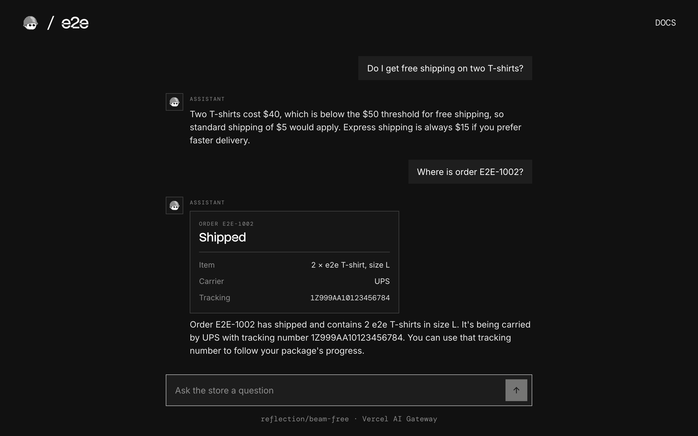

# e2e-ai-chat

A support chat that answers with a real model through the AI SDK and the Vercel AI Gateway, used as an example of end-to-end testing AI answers with [e2e](https://www.npmjs.com/package/e2e).



## How it works

The e2e Store's support assistant answers questions about shipping, returns, and sizes, and looks up orders with a tool:

- **Chat** (`components/chat.tsx`) sends the conversation with the AI SDK's `useChat` and streams the reply in. When a request fails, it shows an error and a Retry button.
- **`POST /api/chat`** (`app/api/chat/route.ts`) calls `reflection/beam-free`, a free model, through the Vercel AI Gateway, with the store's policy and a `lookUpOrder` tool (`lib/assistant.ts`).
- **Order card** (`components/order-card.tsx`) shows what the tool found in a fixed list of orders (`lib/orders.ts`).

There is no database and no history: the conversation lives in the page until you reload. A real model words its answers differently on every run, which is why Vercel's [Chatbot template](https://chatbot.ai-sdk.dev/docs/customization/testing) tests with mock models. These tests call the real one and judge what each reply means.

### Test inputs

| Ask                                       | The assistant                         |
| ----------------------------------------- | ------------------------------------- |
| "Do I get free shipping on two T-shirts?" | Says no: $40 is under the $50 minimum |
| "How long do I have to return a T-shirt?" | 45 days from delivery                 |
| "Where is order E2E-1002?"                | Looks it up and shows a card          |
| "Write a short poem about the sea."       | Politely declines                     |

| Order         | Status                            |
| ------------- | --------------------------------- |
| `E2E-1001`    | Delivered                         |
| `E2E-1002`    | Shipped, UPS `1Z999AA10123456784` |
| `E2E-1003`    | Processing                        |
| Anything else | Not found                         |

## Getting started

```bash
npm install
npm run dev
```

Open [http://localhost:3000](http://localhost:3000).

### AI Gateway key

The chat's model and the e2e agent both go through the Vercel AI Gateway. Create a key under [AI Gateway → API keys](https://vercel.com/d?to=%2F%5Bteam%5D%2F%7E%2Fai-gateway%2Fapi-keys&title=AI+Gateway+API+Keys) in the Vercel dashboard, copy `.env.example` to `.env.local`, and set `AI_GATEWAY_API_KEY`.

Or link a Vercel project and run `vercel env pull .env.local`, which writes a `VERCEL_OIDC_TOKEN` that lasts 12 hours.

The chat runs on `reflection/beam-free`, a free model, so trying it costs nothing. The e2e agent's model isn't free: the AI Gateway charges the provider's list price, and its free monthly credit covers only [some models](https://vercel.com/ai-gateway/models?freeTier=true).

## End-to-end tests

The tests in `tests/chat.e2e.ts` ask the real model four things: a shipping question, an order (answered with the tool's card), an off-topic request, and a question whose request fails with a 500 until Retry. Exact locators type and click on our page and check what is fixed: the order card's data and the error message. `agent.waitFor` waits until a reply has streamed in, and `agent.assert` judges what it says. Two tests also ask the AI Gateway's API which model answered and whether a step called the tool. `tests/home.e2e.ts` checks the empty page with locators only and needs no key.

A full run takes about 50 seconds and costs about $0.003 in agent model calls. With the dev server running:

```bash
npm run test:e2e
```

To test a different URL, set `APP_URL`. Configuration lives in `e2e.config.ts`.

## Scripts

| Command            | Description          |
| ------------------ | -------------------- |
| `npm run dev`      | Start the dev server |
| `npm run build`    | Build for production |
| `npm run lint`     | Run ESLint           |
| `npm run format`   | Format with Prettier |
| `npm run test:e2e` | Run the e2e tests    |
